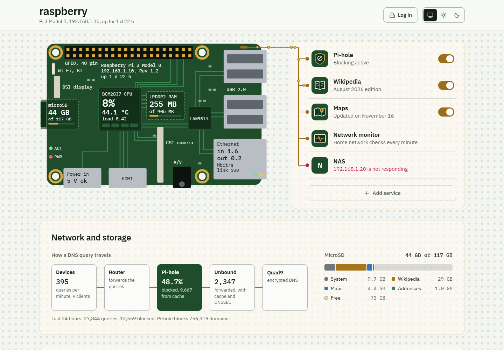
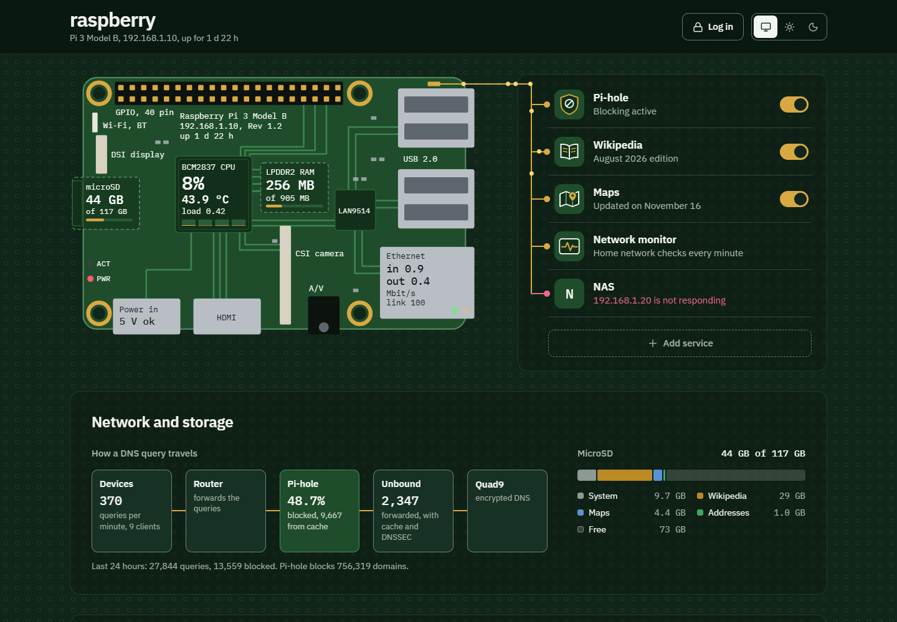
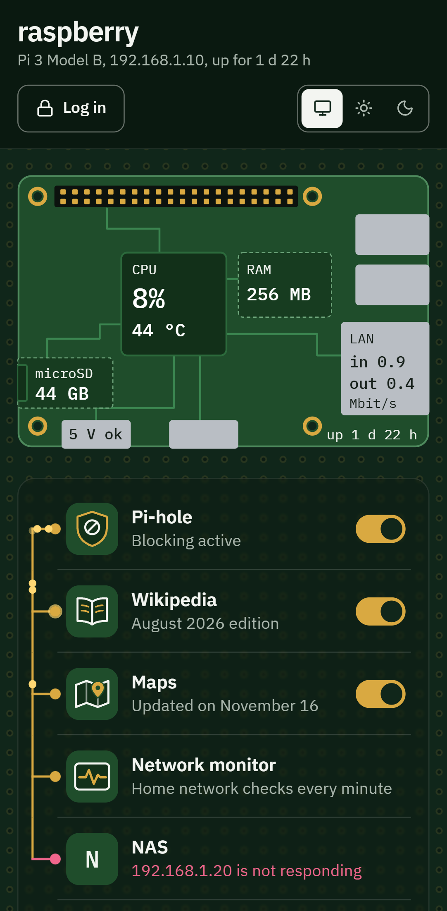
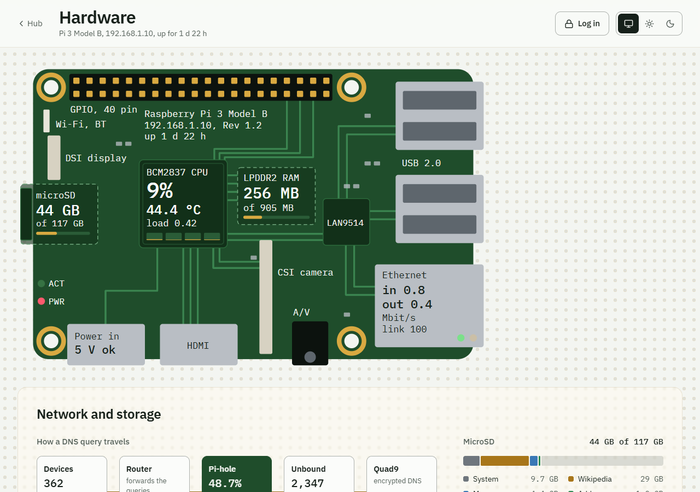

# raspberry hub

[](https://github.com/Dxz0-96/raspberry-hub/actions/workflows/ci.yml)
[](https://github.com/Dxz0-96/raspberry-hub/releases)
[](LICENSE)
[](CONTRIBUTING.md#commit-messages)

A home page for your Raspberry Pi at `https://raspberry`: open the services it runs (Pi-hole, offline
Wikipedia, offline maps with address search, a network monitor and anything you add), switch them on and
off, and see how the hardware is doing. Everything runs on the Raspberry Pi, without cloud services.



**[Try the demo](https://dxz0-96.github.io/raspberry-hub/)**: the hub of the latest release in your browser, with
a made-up Raspberry Pi. The switches and "Add service" work (log in as `admin`, password `demo`) and everything
goes back to the start when the page reloads; the map has central Rome only, and Wikipedia is switched off.

| Dark theme | Phone | Italian |
|---|---|---|
|  |  |  |

| Offline maps with address search | Offline Wikipedia | Hardware |
|---|---|---|
|  |  |  |

Tested on a Raspberry Pi 3 Model B with 64-bit Debian 13 and Pi-hole v6 (November 2026). No Docker: only
system services run on the Pi. (Docker's default network, 172.17.x.x, clashes with routers that forward
DNS from those addresses.)

## Features

- **Services at a glance**: each one shows whether it is up, with live traffic pulses running from the board
  to the services people are using.
- **Switches**: Wikipedia, maps and ad blocking can be switched off and on from the hub; the choice survives reboots.
- **Your own links**: add the NAS, the router or the printer from the hub, with a name and an icon.
- **Hardware monitor**: CPU, temperature, memory, microSD, network and power drawn on a picture of the board,
  with the last hour, the last 24 hours and the last month as charts (the month with the peak of every hour),
  readable with the keyboard too, and alerts when something needs attention.
- **Looking after the Pi**: how often the power supply was too weak, a check after every boot, an optional
  hardware watchdog, and support for the content on a USB disk (see [below](#looking-after-the-raspberry-pi)).
- **DNS at home**: how a query travels from your devices through Pi-hole and Unbound, with real numbers.
- **Offline maps** (Protomaps) with **address search** down to the house number, from OpenStreetMap data.
- **Offline Wikipedia** (Kiwix) restyled to match the hub, in light and dark.
- **In the language of the browser**: English, Italian, Spanish, French and German; light and dark theme,
  usable on phones, keyboard and screen readers.

## Requirements

- A Raspberry Pi with 64-bit Debian (or Raspberry Pi OS) and Pi-hole v6 already installed.
- The Raspberry Pi's `pi-setup` package, **not included in this repository**: it creates the "home CA" and the
  certificate (`pihole-cert.sh`), the monthly update (`monthly-update.sh`), the backups and the network
  monitor (`/netmon/`). `hub-install.sh` expects to live in `~/pi-setup/hub` and skips the steps that need
  it if it cannot find it.
- On the PC: Node.js 20 or newer, and PowerShell for `deploy.ps1`.
- Browsers: any recent one. The offline map needs WebGL 2 (every current browser has it); without it the
  map page says so instead of drawing.
- Disk space: about 30 GB for Wikipedia (full Italian edition), 5 GB for the maps of Italy, 1 GB for the
  address index (6 GB free while it is built).

## How it is built

```
https://raspberry  ->  Caddy (ports 80 and 443, certificate from the "home CA")
   /             hub website (Next.js, static export)                /srv/hub/site
   /maps/        map (MapLibre) reading /tiles/basemap.pmtiles       /srv/hub/maps
   /search       address search   hub-search.py   127.0.0.1:8082     /srv/hub/search/addresses.db
   /control/     status, switches, hardware monitor   hub-control.py   127.0.0.1:8083
   /wiki/        offline Wikipedia   kiwix-serve   127.0.0.1:8081    /srv/hub/zim
   /admin /api /netmon   Pi-hole (its web server listens only on 127.0.0.1:8080)
   /services.json /icons/   list of services and their images     /srv/hub/config, /srv/hub/icons
```

| Folder | Content |
|---|---|
| `hub/` | The interface: Next.js + React, built into a static site. Node does not run on the Pi. |
| `pi/` | Everything that goes on the Raspberry Pi: Caddyfile, systemd services, scripts. On the Pi it lives in `~/pi-setup/hub`. |
| `deploy.ps1` | Builds the hub and publishes it on the Raspberry Pi; with `-Update` it also installs the `pi/` scripts. Its settings are in `.env` (template: `.env.example`). |
| `docs/` | Screenshots used by this README (`npm run screenshots` in `hub/` refreshes them). |

## Installation

There are two ways: from a **release package**, on the Raspberry Pi alone, or **from a PC** with a clone of this
repository (needed to try changes that are not released yet). Releases newer than 2.0.1 carry a package.

### From a release package (no PC needed)

On the Raspberry Pi, with the version you want from the [releases page](https://github.com/Dxz0-96/raspberry-hub/releases):

```bash
V=X.Y.Z
mkdir -p ~/pi-setup/hub && cd ~/pi-setup/hub
curl -fsSLO "https://github.com/Dxz0-96/raspberry-hub/releases/download/v$V/raspberry-hub-$V.tar.gz"
curl -fsSL "https://github.com/Dxz0-96/raspberry-hub/releases/download/v$V/SHA256SUMS" | sha256sum -c -
tar -xzf "raspberry-hub-$V.tar.gz" --strip-components=1 && rm "raspberry-hub-$V.tar.gz"
sudo bash hub-install.sh
```

The package holds the `pi/` folder with the website already built (`site.tar.gz`). GitHub
[artifact attestations](https://github.com/Dxz0-96/raspberry-hub/attestations) prove that this repository's
release workflow built it: `gh attestation verify raspberry-hub-$V.tar.gz --repo Dxz0-96/raspberry-hub`.
Then continue from step 3 below.

### From a PC

1. Clone this repository on your PC and set your Raspberry Pi address once: copy
   [`.env.example`](.env.example) to `.env` (ignored by git) and edit it:

   ```dotenv
   PI_HOST=pi@192.168.1.10
   PI_SSH_KEY=~/.ssh/id_ed25519
   HUB_URL=https://raspberry/
   ```

   `deploy.ps1` only reads these `KEY=value` lines, it never runs them. `-Pi` and `-Key` on the command line
   win over them, and an older `deploy.local.ps1` keeps working (see [docs/upgrading.md](docs/upgrading.md#deploy-settings-in-env)).

2. Build the site and copy everything to the Pi, then run the installer there:

   ```powershell
   .\deploy.ps1 -Update
   ```

   This builds the site, copies the `pi/` folder to `~/pi-setup/hub` and runs `sudo bash hub-install.sh`
   (it asks for your sudo password on the Pi). The installer can also be run by hand, step by step:
   `prepare`, `site`, `enable`, `monthly` (see the top of [`pi/hub-install.sh`](pi/hub-install.sh)).

3. On the Pi, choose the username and password for the switches:

   ```bash
   sudo hub-control-setpass
   ```

4. Import the home CA on each device (see [HTTPS certificate](#https-certificate)) and open `https://raspberry/`.

Wikipedia and maps start **switched off**: switch them on from the hub when you need them. Their content is
downloaded by the monthly update, or right away with `sudo hub-update.sh`.

## Updating

New versions are published on the [releases page](https://github.com/Dxz0-96/raspberry-hub/releases), with
their notes (also in [CHANGELOG.md](CHANGELOG.md)). Ways to hear about them:

- **In the hub**: once a day the Raspberry Pi asks GitHub for the latest release (`hub-version-check.timer`),
  and the footer says "Version X.Y.Z is available" with its notes. GitHub sees only the public address of your
  home, as for the map downloads; `CHECK_FOR_UPDATES=no` in `/etc/hub.conf` turns the check off.
- **A message**: `NOTIFY_NEW_VERSION=netmon` in `/etc/hub.conf` (Telegram, with the `pi-setup` package), or
  the address of an [ntfy](https://ntfy.sh) topic, free and without an account
  (`NOTIFY_NEW_VERSION=https://ntfy.sh/a-name-only-you-know`). One message per new version; off by default.
- **GitHub**: "Watch" → "Custom" → "Releases" on the repository sends an email for each release (needs a
  GitHub account), and [the releases feed](https://github.com/Dxz0-96/raspberry-hub/releases.atom) works in any
  RSS reader without one.

**Update from the hub**: next to the notice, "Update" (after logging in) shows the release notes and, for a new
major version, the link to what changes. Once confirmed, the Raspberry Pi runs the same upgrade as
`sudo hub-install.sh upgrade` below and the hub shows its steps: download, check, installation, check after the
restart. The hub stops answering for a minute or two meanwhile, and the page reloads by itself when the new
version answers. Only the latest release found by the daily check can be installed this way, never during a
content update. Behind the button there is a systemd unit, `hub-upgrade@X.Y.Z.service`, that `hub-control` may
only start (the same polkit rule as the switches).

Version numbers follow
[Semantic Versioning](https://semver.org/): a new **major** version (2.0.0, 3.0.0) changes something on the
Raspberry Pi that has to be converted, so read its section in [docs/upgrading.md](docs/upgrading.md) first.

1. **Before a major version, back up** the hub settings on the Raspberry Pi (a few MB; the downloaded
   Wikipedia, maps and address index are not included and do not need to be):

   ```bash
   sudo tar --ignore-failed-read -czf ~/hub-backup.tar.gz /etc/hub.conf /etc/hub-control /etc/caddy /srv/hub/config /srv/hub/icons /srv/hub/icone /var/lib/hub-control
   ```

   (`/srv/hub/icone` is where 1.x kept the icons; `--ignore-failed-read` skips whichever of the two is missing.)

2. **Update**, on the Raspberry Pi (once the installed version has this command, 2.0.1 does not yet):

   ```bash
   sudo hub-install.sh upgrade          # the latest release
   sudo hub-install.sh upgrade 2.1.0    # a given version
   ```

   It downloads the release package, checks its SHA-256, unpacks it into `~/pi-setup/hub` and runs its
   `hub-install.sh`, the same installer as the first time. Before a new major version it shows the matching
   section of [docs/upgrading.md](docs/upgrading.md) and asks for confirmation (`--yes` skips the question).
   It never installs a pre-release or an older version, waits for a content update to finish, and at the end
   checks that the hub answers with the new version (`sudo hub-check.sh`). The output also goes to
   `/srv/hub/state/upgrade.log`.

   **From a PC** instead, in the folder of this repository: `git switch main`, `git pull`, then
   `.\deploy.ps1 -Update`. It takes a few minutes and asks for your sudo password on the Raspberry Pi: it
   installs the dependencies of the website again if they changed, builds it, copies the `pi/` folder to
   `~/pi-setup/hub` and runs `sudo bash hub-install.sh` there.

   Either way, the installer converts whatever changed (`pi/hub-migrate.py`; nothing, when nothing changed),
   installs the new scripts, services, website and Caddy configuration, and keeps your settings, added
   services, switch states, password and downloaded content. Pi-hole keeps answering DNS; the hub is
   unreachable only for the few seconds Caddy restarts.

3. **Check** on the Raspberry Pi:

   ```bash
   sudo hub-check.sh
   ```

   The first line shows the version just installed (`raspberry-hub X.Y.Z`) and every check should say
   `[ ok ]` or `[ -- ]` (skipped on purpose, for example Wikipedia switched off). In the hub, the footer shows
   the same version.

If the update stops with an error, its output and `sudo hub-check.sh` say which step failed; run it again once
it is fixed. `sudo bash hub-install.sh disable` puts Pi-hole back on ports 80 and 443 meanwhile (see
[Rolling back](#rolling-back)). There is no automatic downgrade to an older major version: that is what the
backup is for.

Changes to the interface only can be published faster with `.\deploy.ps1` (without `-Update`), which copies
just the website. If the website and the Raspberry Pi scripts end up on different versions, the footer of the
hub says so and suggests `.\deploy.ps1 -Update`.

> **Upgrading from 1.x** (the Italian-named version): the steps above, once. Files, settings, the address
> index and the old URLs are converted automatically; bookmarks to `/mappe/` keep working; every device has
> to log in once more. What changes, and how to tidy up afterwards: [docs/upgrading.md](docs/upgrading.md).

## Everyday use

| What | How |
|---|---|
| Open the hub | `https://raspberry/` (import the CA on each device the first time: see below) |
| Switch Wikipedia, maps or ad blocking on or off | The switch next to the service; it asks for username and password |
| Add a link (NAS, router, printer) | "Add service" in the hub, with name, address and image |
| Add a service that runs on the Pi | On the Pi: `sudo hub-service add` (publishes it under `https://raspberry/<path>/` and can give it a switch) |
| Change the hub username and password | On the Pi: `sudo hub-control-setpass`. Password only: from the hub, user menu, "Change password" |
| Update Wikipedia, maps, addresses now | On the Pi: `sudo hub-update.sh` (or `wiki`, `maps`, `addresses`) |
| Check that everything is up | On the Pi: `sudo hub-check.sh` |
| Install a new release | "Update" in the footer of the hub, when it says a new version is available; or on the Pi: `sudo hub-install.sh upgrade` (see [Updating](#updating)) |
| Change the Wikipedia variant or the map area | `/etc/hub.conf`, then `sudo hub-update.sh` |
| Change the language | In the browser settings (preferred languages): the hub follows them |

With ad blocking paused, the network monitor reports it as a fault on Telegram after two minutes.

### Language

The hub speaks English, Italian, Spanish, French and German, and always uses the language of the browser: the
first of its preferred languages that the hub knows (`fr-CH` counts as French), English if there is none. There
is no switch in the page: to change it, change the preferred languages in the browser settings, and the hub
follows right away. The map labels follow the same language. The labels printed on the board drawing stay in
English, like a real silkscreen.

The language of the interface is not a place: it changes neither the map area, nor the address data, nor the
Wikipedia edition that the Raspberry Pi downloads.

## Credentials

| What | Credentials | Where to change them |
|---|---|---|
| Switches and "Add service" | Username (`admin` unless you change it) and a password you choose | `sudo hub-control-setpass` |
| Pi-hole dashboard | The Pi-hole password | `sudo pihole setpassword` |
| Service status, hardware monitor, Wikipedia, maps | None | |

The hub password is stored in `/etc/hub-control/credentials.json` only as an scrypt hash. After 5 wrong
attempts the login is locked for 5 minutes. Once logged in you stay logged in until "Log out", even after a
reboot of the Raspberry Pi: the cookie lasts 400 days and renews itself once a day while the hub is in use.
Only the hashes of the sessions are kept on the Pi (`/var/lib/hub-control/sessions.json`); changing the
password, from the hub or with `sudo hub-control-setpass`, logs out every other device.

## HTTPS certificate

The certificate is issued by the "home CA" created by `pihole-cert.sh` (`pi-setup` package), valid only for
`raspberry`, `pi.hole` and the IP address of the Raspberry Pi. Import the CA once on each device:

1. Download `http://raspberry/ca.crt` (also linked in the footer of the hub).
2. Windows: double-click, Install certificate, Local machine, "Trusted Root Certification Authorities".
3. Restart the browser.

Renewal is automatic: `pihole-cert.sh` renews the certificate and `hub-cert-sync.path` hands it to Caddy.

## What happens by itself

| When | What |
|---|---|
| At boot | Caddy, the control service and, if switched on, Wikipedia and address search start; then `hub-check.service` checks that everything came back (a failure becomes an alert in the hub) |
| Every 5 seconds | The control service samples the hardware. The last hour and 24 hours stay in memory; the last month (one point per hour, about 30 KB) is written to `/var/lib/hub-control` only when the service stops and once a day, so a reboot does not empty it |
| Every day | Asks GitHub for the latest release, for the notice in the hub (`CHECK_FOR_UPDATES` in `/etc/hub.conf`) |
| Sunday 04:30 | Certificate check (`pi-setup` package) |
| 1st of the month, 03:00 | After the system and Pi-hole: new Wikipedia edition if one came out, maps and address index rebuilt, then reboot |

Offline Wikipedia has no incremental updates: each edition is a new file (about 30 GB), downloaded only when
it comes out. Maps (4.7 GB) and addresses are rebuilt when they are more than 20 days old.

## Looking after the Raspberry Pi

What shortens the life of a Raspberry Pi 3 and of its microSD, and what the hub does about it:

- **Power supply.** The control service reads the power state every 30 seconds. Trends shows how many times the
  voltage dropped too low (under-voltage) or the processor slowed down to protect itself (throttling) in the
  period shown, and the alert says what to do. Under-voltage is the first cause of corrupted microSD cards: use
  the official 2.5 A power supply, with its short cable. A dip shorter than 30 seconds is counted too, but only
  the first one after each reading that had none.
- **Check after boot.** `hub-check.service` runs `hub-check.sh --wait` after every boot (the monthly update
  ends with one) and writes the result to `/run/hub-check.json`, in memory. If something did not come back,
  the hub shows an alert; `sudo hub-check.sh` on the Pi says what. The parts of the `pi-setup` package are
  skipped when it is not installed.
- **Hardware watchdog** (off unless you turn it on). With `WATCHDOG=yes` in `/etc/hub.conf` and then
  `sudo hub-install.sh watchdog`, systemd keeps telling the watchdog of the board that all is well: a Raspberry
  Pi that hangs reboots by itself after about 14 seconds. `WATCHDOG=no` and the same command turn it off.
- **Content on a USB disk.** Every month the maps (about 5 GB) and the address index (1 GB, with up to 6 GB of
  temporary files) are rebuilt, and each new Wikipedia edition is about 30 GB: that is a lot of writing for a
  microSD. A USB SSD mounted on `/srv/hub` takes it all, with no change to the hub, and the storage panel then
  says "USB disk". The USB ports of a Pi 3 share 1.2 A: an SSD may need a powered adapter.

  ```bash
  lsblk -f                                    # find the disk, for example sda1, and its UUID
  # sudo mkfs.ext4 -L hub /dev/sda1           # only for a new disk: this erases it
  sudo systemctl stop caddy kiwix-hub hub-search hub-control
  sudo mount /dev/sda1 /mnt && sudo cp -a /srv/hub/. /mnt/ && sudo umount /mnt
  sudo mv /srv/hub /srv/hub.sd && sudo mkdir /srv/hub
  echo "UUID=<the UUID of sda1> /srv/hub ext4 defaults,noatime,nofail 0 2" | sudo tee -a /etc/fstab
  sudo systemctl daemon-reload && sudo mount /srv/hub
  sudo systemctl start hub-control kiwix-hub hub-search caddy && sudo hub-check.sh
  sudo rm -rf /srv/hub.sd                     # once everything works
  ```

  `nofail` lets the Raspberry Pi start without the disk; the hub website lives on it too, so without the disk
  only Pi-hole answers until it is back (`sudo mount /srv/hub`, then restart the services as above).

## Development

```
cd hub
npm install
npm run assets          # map fonts and icons, once
npm run build
npm run mock            # mock Raspberry Pi on http://localhost:8790 (test login: admin / test1234)
```

To try the map and search with the real data of the Raspberry Pi: open a tunnel with
`ssh -N -L 8443:127.0.0.1:443 user@raspberry-address`, put the home CA certificate in `home-ca.crt` in the
repository root (ignored by git), then run `node dev/mock-pi.mjs` and open `http://localhost:8791/maps/`.
The maps must be switched on. Through the tunnel the first load is slower than at home: connected directly
to the Raspberry Pi each map tile arrives in 50-150 ms.

The demo on GitHub Pages is the same site built with `npm run demo` (into `out-demo/`, never the site copied to
the Raspberry Pi): `lib/demo.ts` answers in the browser what the Raspberry Pi would, with the made-up data of
`dev/pretend-pi.mjs`, the same the mock serves. `node scripts/serve-demo.mjs` shows it on
`http://localhost:8796/raspberry-hub/`, `npm run test:demo` tests it. `.github/workflows/demo.yml` publishes it
after every release, or by hand from the Actions page.

The maps page keeps the position in the address (`/maps/#position=zoom/lat/lon`): reloading keeps it, and
such an address can be saved as a bookmark.

All interface text lives in [`hub/lib/messages/`](hub/lib/messages/), one dictionary per language, listed in
[`index.ts`](hub/lib/messages/index.ts); TypeScript and `tests/i18n.spec.ts` check that they all have the keys of
the English one.
The list of services is not in the code: on the Pi it is `/srv/hub/config/services.json`.

## Tests

| Command | What it checks |
|---|---|
| `npm run typecheck` (in `hub/`) | TypeScript |
| `npm run smoke` (in `hub/`, after a build) | Every page and API of the built site answers, served by the mock Raspberry Pi |
| `npx playwright test` (in `hub/`) | End-to-end: home, switches and login, maps, Wikipedia, every interface language, on desktop and on a simulated phone |
| `python3 -m unittest discover -s pi/tests` | Pi scripts: address index and search, upgrade from 1.x, `hub-control` API |

The Playwright tests run on the built site with a small map of central Rome
(`hub/tests/fixtures/rome.pmtiles`, OpenStreetMap data) and a fake Wikipedia (`hub/dev/fake-wikipedia.mjs`):
no Raspberry Pi needed. Install the browser once with `npx playwright install chromium`; `npm run test:all`
builds and tests in one go. GitHub Actions runs all of the above, plus ShellCheck and the commit convention,
on every pull request.

Pull requests that touch `pi/` also run `hub-install.sh` for real ("Install on Debian"): in a Debian 13 arm64
container with systemd, on GitHub's arm64 runners, on a clean system and on a 1.x installation, twice (the second
run must change nothing), then they check the services, the API and the conversions. Pi-hole is not there, so
the `enable` step is not run. The same runs on the next Debian release (testing) without blocking, to see
breakages before people upgrade their Raspberry Pi. `.github/scripts/install-test.sh` is the script.

Every Monday, the "Content sources" workflow checks that the sources of the monthly update still answer the
way the scripts expect: the Kiwix listing and checksums, the Protomaps builds, the Photon address dump (its
first lines go through `build-search-index.py`), the pinned `go-pmtiles` release and the map assets. Nothing
big is downloaded. When a check fails it opens an issue, so there is time to fix it before the 1st of the
month; `bash .github/scripts/check-sources.sh` runs the same checks by hand.

## Troubleshooting

| Symptom | Check |
|---|---|
| The hub does not open | On the Pi: `systemctl status caddy`; `sudo hub-check.sh` |
| Browser warning about the certificate | Import `http://raspberry/ca.crt` on the device |
| "This service is off or not responding" | Switch it on from the hub; if it was on, `systemctl status kiwix-hub hub-search` |
| Service status does not arrive | `systemctl status hub-control` |
| Address search does not answer | Is the index there? `ls -la /srv/hub/search`; rebuild it: `sudo hub-update.sh addresses` |
| `raspberry` sometimes does not answer | The router has two addresses for that name: remove the old device called `raspberry` from the router |

### Rolling back

```
cd ~/pi-setup/hub
sudo bash hub-install.sh disable        # Pi-hole back on ports 80/443, Caddy stopped
sudo systemctl disable --now kiwix-hub hub-search hub-control hub-cert-sync.path
sudo cp /usr/local/sbin/monthly-update.sh.bak /usr/local/sbin/monthly-update.sh
sudo rm -rf /srv/hub                    # only if you also want to free the space used by the content
```

## Contributing

Contributions are welcome: read [CONTRIBUTING.md](CONTRIBUTING.md) (setup, tests, commit messages) and the
[Code of Conduct](CODE_OF_CONDUCT.md). Security problems: see [SECURITY.md](SECURITY.md). Notes for AI
coding agents are in [AGENTS.md](AGENTS.md).

## Data and licenses

Code: MIT license, see [LICENSE](LICENSE).

Maps and addresses: © OpenStreetMap contributors, ODbL license, through Protomaps and the Photon/Nominatim
dump by GraphHopper. Offline Wikipedia: Kiwix, text under CC BY-SA 4.0. Fonts: IBM Plex (SIL Open Font
License) and Noto Sans for the map labels.
