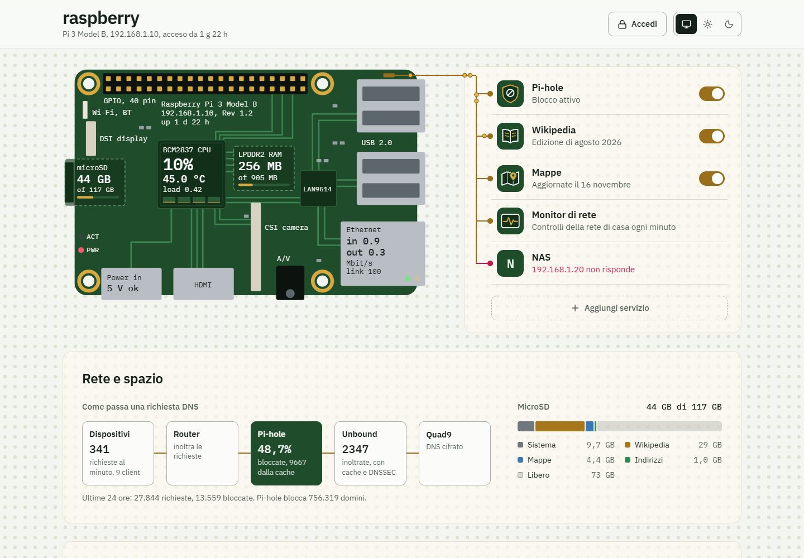
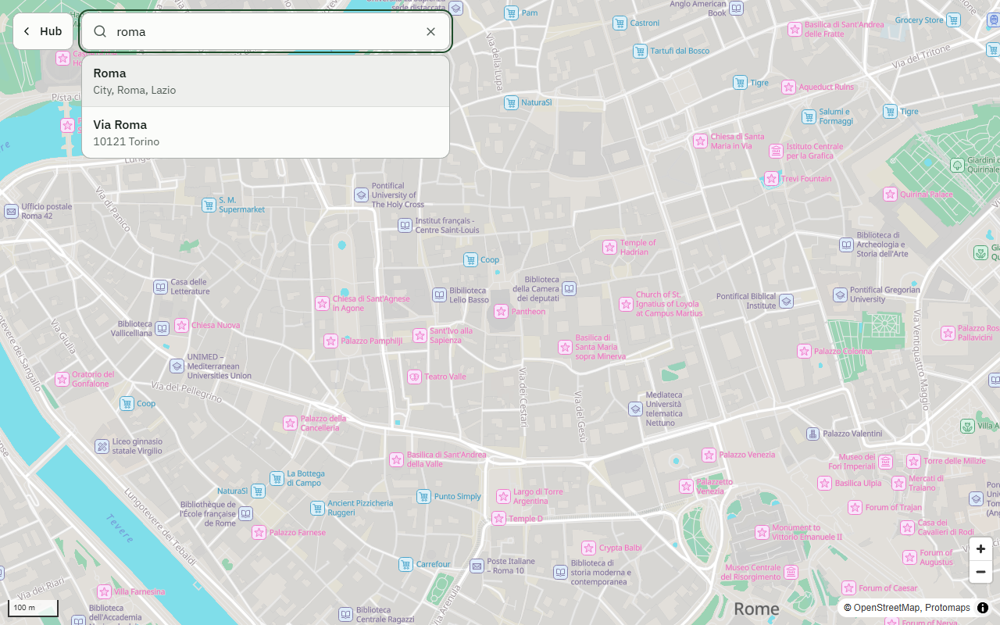
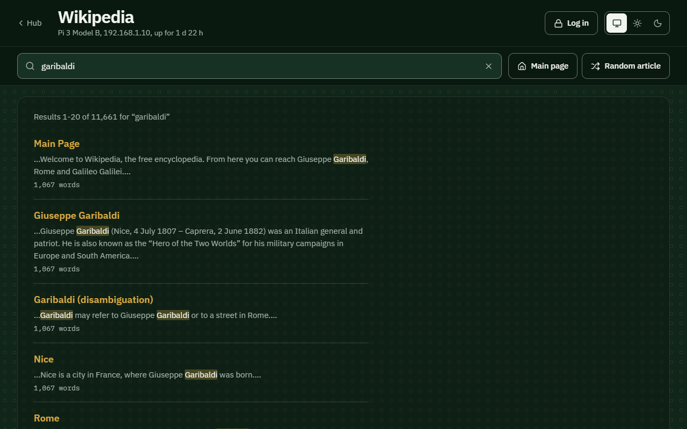

# raspberry hub

[](https://github.com/Dxz0-96/raspberry-hub/actions/workflows/ci.yml)
[](https://github.com/Dxz0-96/raspberry-hub/releases)
[](LICENSE)
[](CONTRIBUTING.md#commit-messages)

A home page for your Raspberry Pi at `https://raspberry`: open the services it runs (Pi-hole, offline
Wikipedia, offline maps with address search, a network monitor and anything you add), switch them on and
off, and see how the hardware is doing. Everything runs on the Raspberry Pi, without cloud services.


| Dark theme | Phone | Italian |
|---|---|---|
|  |  |  |

| Offline maps with address search | Offline Wikipedia | Hardware |
|---|---|---|
|  |  |  |

Tested on a Raspberry Pi 3 Model B with 64-bit Debian 13 and Pi-hole v6 (November 2026). No Docker: only
system services run on the Pi. (Docker's default network, 172.17.x.x, clashes with routers that forward
DNS from those addresses.)

## Features

- **Services at a glance**: each one shows whether it is up, with live traffic pulses running from the board
  to the services people are using.
- **Switches**: Wikipedia, maps and ad blocking can be switched off and on from the hub; the choice survives reboots.
- **Your own links**: add the NAS, the router or the printer from the hub, with a name and an icon.
- **Hardware monitor**: CPU, temperature, memory, microSD, network and power drawn on a picture of the board,
  with the last hour and the last 24 hours as charts, and alerts when something needs attention.
- **DNS at home**: how a query travels from your devices through Pi-hole and Unbound, with real numbers.
- **Offline maps** (Protomaps) with **address search** down to the house number, from OpenStreetMap data.
- **Offline Wikipedia** (Kiwix) restyled to match the hub, in light and dark.
- **English and Italian**, light and dark theme, usable on phones, keyboard and screen readers.

## Requirements

- A Raspberry Pi with 64-bit Debian (or Raspberry Pi OS) and Pi-hole v6 already installed.
- The Raspberry Pi's `pi-setup` package, **not included in this repository**: it creates the "home CA" and the
  certificate (`pihole-cert.sh`), the monthly update (`monthly-update.sh`), the backups and the network
  monitor (`/netmon/`). `hub-install.sh` expects to live in `~/pi-setup/hub` and skips the steps that need
  it if it cannot find it.
- On the PC: Node.js 20 or newer, and PowerShell for `deploy.ps1`.
- Browsers: any recent one. The offline map needs WebGL 2 (every current browser has it); without it the
  map page says so instead of drawing.
- Disk space: about 30 GB for Wikipedia (full Italian edition), 5 GB for the maps of Italy, 1 GB for the
  address index (6 GB free while it is built).

## How it is built

```
https://raspberry  ->  Caddy (ports 80 and 443, certificate from the "home CA")
   /             hub website (Next.js, static export)                /srv/hub/site
   /maps/        map (MapLibre) reading /tiles/basemap.pmtiles       /srv/hub/maps
   /search       address search   hub-search.py   127.0.0.1:8082     /srv/hub/search/addresses.db
   /control/     status, switches, hardware monitor   hub-control.py   127.0.0.1:8083
   /wiki/        offline Wikipedia   kiwix-serve   127.0.0.1:8081    /srv/hub/zim
   /admin /api /netmon   Pi-hole (its web server listens only on 127.0.0.1:8080)
   /services.json /icons/   list of services and their images     /srv/hub/config, /srv/hub/icons
```

| Folder | Content |
|---|---|
| `hub/` | The interface: Next.js + React, built into a static site. Node does not run on the Pi. |
| `pi/` | Everything that goes on the Raspberry Pi: Caddyfile, systemd services, scripts. On the Pi it lives in `~/pi-setup/hub`. |
| `deploy.ps1` | Builds the hub and publishes it on the Raspberry Pi; with `-Update` it also installs the `pi/` scripts. |
| `docs/` | Screenshots used by this README (`npm run screenshots` in `hub/` refreshes them). |

## Installation

1. Clone this repository on your PC and set your Raspberry Pi address once in `deploy.local.ps1`
   (ignored by git):

   ```powershell
   $DefaultPi = "pi@192.168.1.10"
   $DefaultKey = "$env:USERPROFILE\.ssh\id_ed25519"
   ```

2. Build the site and copy everything to the Pi, then run the installer there:

   ```powershell
   .\deploy.ps1 -Update
   ```

   This builds the site, copies the `pi/` folder to `~/pi-setup/hub` and runs `sudo bash hub-install.sh`
   (it asks for your sudo password on the Pi). The installer can also be run by hand, step by step:
   `prepare`, `site`, `enable`, `monthly` (see the top of [`pi/hub-install.sh`](pi/hub-install.sh)).

3. On the Pi, choose the username and password for the switches:

   ```bash
   sudo hub-control-setpass
   ```

4. Import the home CA on each device (see [HTTPS certificate](#https-certificate)) and open `https://raspberry/`.

Wikipedia and maps start **switched off**: switch them on from the hub when you need them. Their content is
downloaded by the monthly update, or right away with `sudo hub-update.sh`.

## Updating

New versions are published on the [releases page](https://github.com/Dxz0-96/raspberry-hub/releases), with
their notes (also in [CHANGELOG.md](CHANGELOG.md)). Version numbers follow
[Semantic Versioning](https://semver.org/): a new **major** version (2.0.0, 3.0.0) changes something on the
Raspberry Pi that has to be converted, so read its section in [docs/upgrading.md](docs/upgrading.md) first.

1. **Before a major version, back up** the hub settings on the Raspberry Pi (a few MB; the downloaded
   Wikipedia, maps and address index are not included and do not need to be):

   ```bash
   sudo tar --ignore-failed-read -czf ~/hub-backup.tar.gz /etc/hub.conf /etc/hub-control /etc/caddy /srv/hub/config /srv/hub/icons /srv/hub/icone /var/lib/hub-control
   ```

   (`/srv/hub/icone` is where 1.x kept the icons; `--ignore-failed-read` skips whichever of the two is missing.)

2. **Get the new version on the PC**, in the folder of this repository:

   ```powershell
   git switch main
   git pull
   ```

3. **Update**:

   ```powershell
   .\deploy.ps1 -Update
   ```

   It takes a few minutes and asks for your sudo password on the Raspberry Pi. It:
   - installs the dependencies of the website again if they changed, and builds it;
   - copies the `pi/` folder to `~/pi-setup/hub` on the Raspberry Pi;
   - runs `sudo bash hub-install.sh` there, the same installer as the first time. It converts whatever changed
     (`pi/hub-migrate.py`; nothing, when nothing changed), installs the new scripts, services, website and
     Caddy configuration, and keeps your settings, added services, switch states, password and downloaded
     content. Pi-hole keeps answering DNS; the hub is unreachable only for the few seconds Caddy restarts.

4. **Check** on the Raspberry Pi:

   ```bash
   sudo hub-check.sh
   ```

   The first line shows the version just installed (`raspberry-hub X.Y.Z`) and every check should say
   `[ ok ]` or `[ -- ]` (skipped on purpose, for example Wikipedia switched off). In the hub, the footer shows
   the same version.

If the update stops with an error, its output and `sudo hub-check.sh` say which step failed; run
`.\deploy.ps1 -Update` again once it is fixed. `sudo bash hub-install.sh disable` puts Pi-hole back on ports
80 and 443 meanwhile (see [Rolling back](#rolling-back)). There is no automatic downgrade to an older major
version: that is what the backup is for.

Changes to the interface only can be published faster with `.\deploy.ps1` (without `-Update`), which copies
just the website. If the website and the Raspberry Pi scripts end up on different versions, the footer of the
hub says so and suggests `.\deploy.ps1 -Update`.

> **Upgrading from 1.x** (the Italian-named version): the steps above, once. Files, settings, the address
> index and the old URLs are converted automatically; bookmarks to `/mappe/` keep working; every device has
> to log in once more. What changes, and how to tidy up afterwards: [docs/upgrading.md](docs/upgrading.md).

## Everyday use

| What | How |
|---|---|
| Open the hub | `https://raspberry/` (import the CA on each device the first time: see below) |
| Switch Wikipedia, maps or ad blocking on or off | The switch next to the service; it asks for username and password |
| Add a link (NAS, router, printer) | "Add service" in the hub, with name, address and image |
| Add a service that runs on the Pi | On the Pi: `sudo hub-service add` (publishes it under `https://raspberry/<path>/` and can give it a switch) |
| Change the hub username and password | On the Pi: `sudo hub-control-setpass`. Password only: from the hub, user menu, "Change password" |
| Update Wikipedia, maps, addresses now | On the Pi: `sudo hub-update.sh` (or `wiki`, `maps`, `addresses`) |
| Check that everything is up | On the Pi: `sudo hub-check.sh` |
| Change the Wikipedia variant or the map area | `/etc/hub.conf`, then `sudo hub-update.sh` |
| Change the language | `EN` / `IT` in the header |

With ad blocking paused, the network monitor reports it as a fault on Telegram after two minutes.

### Language

The hub speaks English and Italian. On a device's first visit it uses the first of the two found in the
browser's preferred languages (English if neither is there). The `EN` / `IT` buttons in the header change it,
and the choice is remembered on that device, like the theme. The labels printed on the board drawing stay in
English in both languages, like a real silkscreen.

## Credentials

| What | Credentials | Where to change them |
|---|---|---|
| Switches and "Add service" | Username (`admin` unless you change it) and a password you choose | `sudo hub-control-setpass` |
| Pi-hole dashboard | The Pi-hole password | `sudo pihole setpassword` |
| Service status, hardware monitor, Wikipedia, maps | None | |

The hub password is stored in `/etc/hub-control/credentials.json` only as an scrypt hash. After 5 wrong
attempts the login is locked for 5 minutes. Once logged in you stay logged in until "Log out", even after a
reboot of the Raspberry Pi: the cookie lasts 400 days and renews itself once a day while the hub is in use.
Only the hashes of the sessions are kept on the Pi (`/var/lib/hub-control/sessions.json`); changing the
password, from the hub or with `sudo hub-control-setpass`, logs out every other device.

## HTTPS certificate

The certificate is issued by the "home CA" created by `pihole-cert.sh` (`pi-setup` package), valid only for
`raspberry`, `pi.hole` and the IP address of the Raspberry Pi. Import the CA once on each device:

1. Download `http://raspberry/ca.crt` (also linked in the footer of the hub).
2. Windows: double-click, Install certificate, Local machine, "Trusted Root Certification Authorities".
3. Restart the browser.

Renewal is automatic: `pihole-cert.sh` renews the certificate and `hub-cert-sync.path` hands it to Caddy.

## What happens by itself

| When | What |
|---|---|
| At boot | Caddy, the control service and, if switched on, Wikipedia and address search start |
| Every 5 seconds | The control service samples the hardware (24 hours of history in memory, nothing on disk) |
| Sunday 04:30 | Certificate check (`pi-setup` package) |
| 1st of the month, 03:00 | After the system and Pi-hole: new Wikipedia edition if one came out, maps and address index rebuilt, then reboot |

Offline Wikipedia has no incremental updates: each edition is a new file (about 30 GB), downloaded only when
it comes out. Maps (4.7 GB) and addresses are rebuilt when they are more than 20 days old.

## Development

```
cd hub
npm install
npm run assets          # map fonts and icons, once
npm run build
npm run mock            # mock Raspberry Pi on http://localhost:8790 (test login: admin / test1234)
```

To try the map and search with the real data of the Raspberry Pi: open a tunnel with
`ssh -N -L 8443:127.0.0.1:443 user@raspberry-address`, put the home CA certificate in `home-ca.crt` in the
repository root (ignored by git), then run `node dev/mock-pi.mjs` and open `http://localhost:8791/maps/`.
The maps must be switched on. Through the tunnel the first load is slower than at home: connected directly
to the Raspberry Pi each map tile arrives in 50-150 ms.

The maps page keeps the position in the address (`/maps/#position=zoom/lat/lon`): reloading keeps it, and
such an address can be saved as a bookmark.

All interface text lives in [`hub/lib/messages/en.ts`](hub/lib/messages/en.ts) and
[`hub/lib/messages/it.ts`](hub/lib/messages/it.ts); TypeScript checks that the two have the same keys.
The list of services is not in the code: on the Pi it is `/srv/hub/config/services.json`.

## Tests

| Command | What it checks |
|---|---|
| `npm run typecheck` (in `hub/`) | TypeScript |
| `npm run smoke` (in `hub/`, after a build) | Every page and API of the built site answers, served by the mock Raspberry Pi |
| `npx playwright test` (in `hub/`) | End-to-end: home, switches and login, maps, Wikipedia, English and Italian, on desktop and on a simulated phone |
| `python3 -m unittest discover -s pi/tests` | Pi scripts: address index and search, upgrade from 1.x, `hub-control` API |

The Playwright tests run on the built site with a small map of central Rome
(`hub/tests/fixtures/rome.pmtiles`, OpenStreetMap data) and a fake Wikipedia (`hub/dev/fake-wikipedia.mjs`):
no Raspberry Pi needed. Install the browser once with `npx playwright install chromium`; `npm run test:all`
builds and tests in one go. GitHub Actions runs all of the above, plus ShellCheck and the commit convention,
on every pull request.

## Troubleshooting

| Symptom | Check |
|---|---|
| The hub does not open | On the Pi: `systemctl status caddy`; `sudo hub-check.sh` |
| Browser warning about the certificate | Import `http://raspberry/ca.crt` on the device |
| "This service is off or not responding" | Switch it on from the hub; if it was on, `systemctl status kiwix-hub hub-search` |
| Service status does not arrive | `systemctl status hub-control` |
| Address search does not answer | Is the index there? `ls -la /srv/hub/search`; rebuild it: `sudo hub-update.sh addresses` |
| `raspberry` sometimes does not answer | The router has two addresses for that name: remove the old device called `raspberry` from the router |

### Rolling back

```
cd ~/pi-setup/hub
sudo bash hub-install.sh disable        # Pi-hole back on ports 80/443, Caddy stopped
sudo systemctl disable --now kiwix-hub hub-search hub-control hub-cert-sync.path
sudo cp /usr/local/sbin/monthly-update.sh.bak /usr/local/sbin/monthly-update.sh
sudo rm -rf /srv/hub                    # only if you also want to free the space used by the content
```

## Contributing

Contributions are welcome: read [CONTRIBUTING.md](CONTRIBUTING.md) (setup, tests, commit messages) and the
[Code of Conduct](CODE_OF_CONDUCT.md). Security problems: see [SECURITY.md](SECURITY.md). Notes for AI
coding agents are in [AGENTS.md](AGENTS.md).

## Data and licenses

Code: MIT license, see [LICENSE](LICENSE).

Maps and addresses: © OpenStreetMap contributors, ODbL license, through Protomaps and the Photon/Nominatim
dump by GraphHopper. Offline Wikipedia: Kiwix, text under CC BY-SA 4.0. Fonts: IBM Plex (SIL Open Font
License) and Noto Sans for the map labels.
